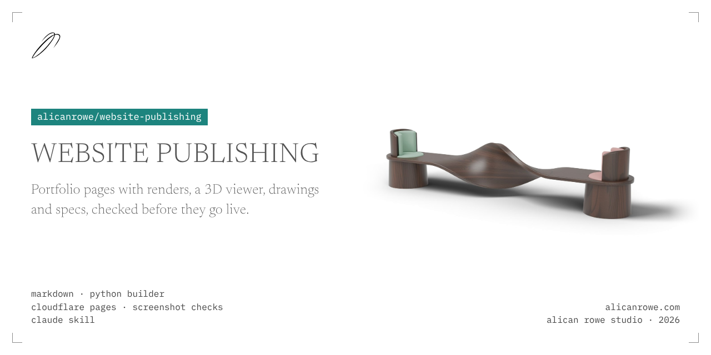

# Website publishing skill (the owner's site)

A Claude skill for adding and changing pages on the owner's site: a static site built from Markdown notes (an Obsidian vault) by a small Python builder and hosted on Cloudflare Pages.

It covers how pages are put together, the brand theme on the web, the inline render / 3D viewer / dimension drawing layout with a spec table, adding a project page, image, video and GLB optimisation, a screenshot check loop, and the PR and deploy flow. The other skills (hardwood furniture CAD, sculpted metal casting, concrete mold casting) hand their outputs to this one for the site part.

## What's in it
- **`SKILL.md`**: the workflow Claude follows.
- **`references/`**
  - `site-structure.md`: repo layout, build, front matter, section markers, hand-built pages, the 3D viewer
  - `brand-on-the-web.md`: fonts, colours, spacing, drawings, and what never goes on the site
  - `inline-layout.md`: render, viewer and drawing side by side, plus the spec table
  - `adding-a-page.md`: a new project page, step by step
  - `media.md`: images, other people's photos, video, GLBs
  - `check-loop.md`: the make-and-check loop with screenshots
  - `pr-and-deploy.md`: branch, PR, Cloudflare deploy, after-merge check
  - `lessons.md`: dated lessons from real site work
- **`templates/project-page.md`**: a project page with the inline layout ready to fill in.
- **`scripts/shoot.mjs`**: builds the site and screenshots pages at 1440 and 390 wide; reports console errors, 404s, broken images, 3D viewers that didn't load and sideways scroll on phone.
- **`scripts/lint_page.py`**: checks a page note for missing files, dead page links, images without alt or size, oversized images, uncompressed GLBs, stacked CSS overrides and brand slips.

## Install
- **Claude.ai / Claude app:** zip this folder and upload it under Settings > Capabilities > Skills.
- **Claude Code:** copy the folder to `~/.claude/skills/website-publishing/`.
- Scripts need Python 3 with Pillow, and Node with Playwright (`npm i -g playwright && npx playwright install chromium`).

## Quick start
```
python3 scripts/lint_page.py --site ~/site-repo mouthpad
node scripts/shoot.mjs --site ~/site-repo --out shots /mouthpad
```

## Authors
- **Alican Rowe** ([@alicanrowe](https://github.com/alicanrowe))
- Claude (Anthropic)

## License
MIT. See `LICENSE`.
